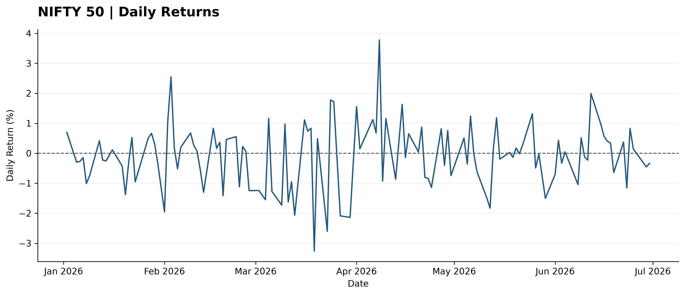
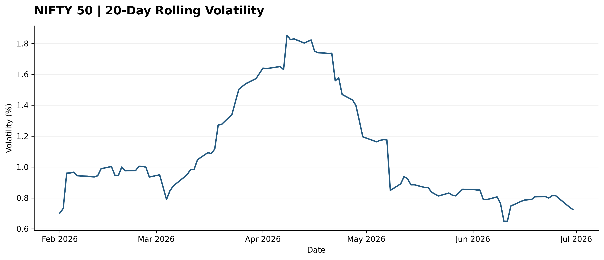
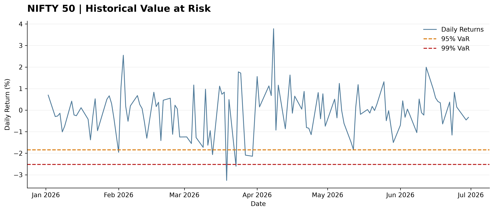
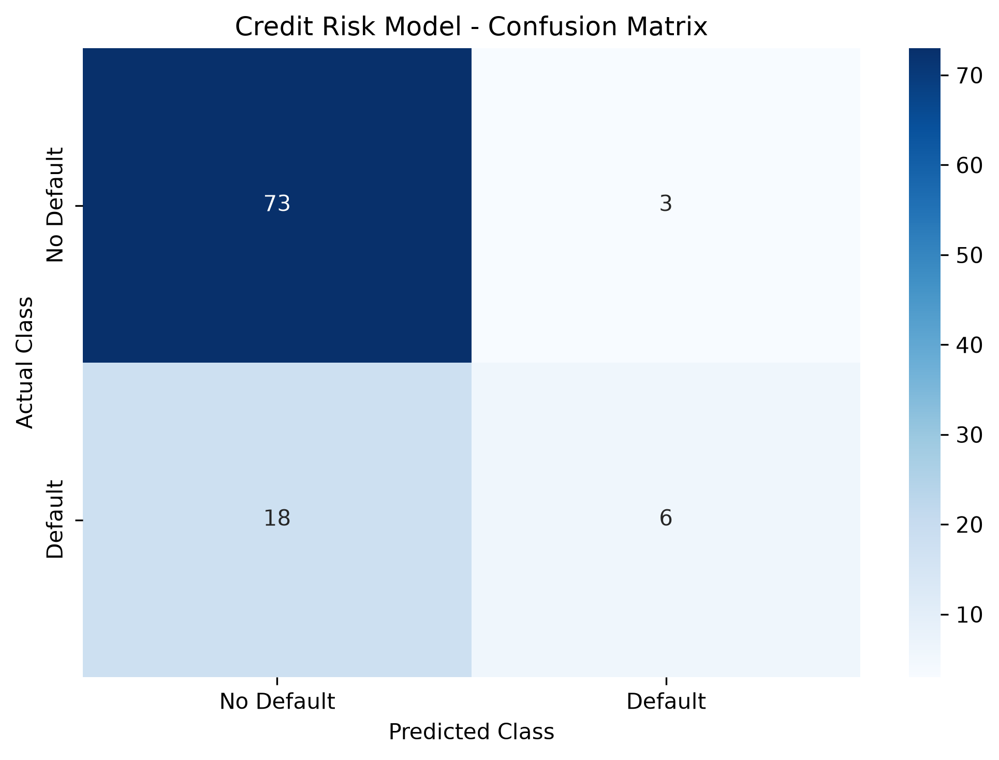
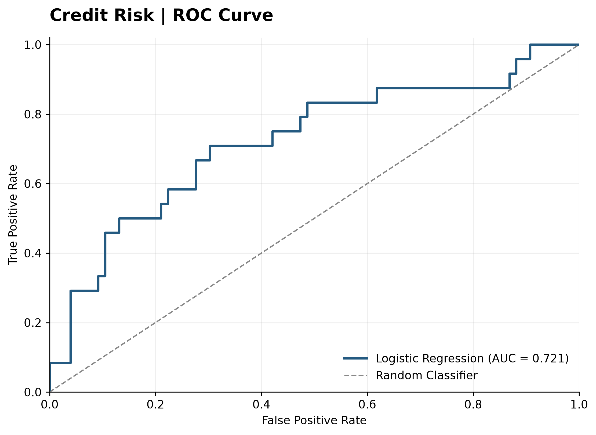

# QuantRisk Analytics
### Market Risk & Credit Risk Modelling Using Python

A quantitative finance project exploring market volatility, downside risk and credit default prediction through statistical analysis and machine learning.


---

## Project Overview

QuantRisk Analytics applies quantitative and statistical techniques to two areas of financial risk:

- **Market Risk:** Examining NIFTY 50 daily returns, volatility and potential downside losses.
- **Credit Risk:** Using logistic regression to study the probability of credit default.

The project uses Python to process financial data, calculate risk measures, build a basic predictive model and interpret the results.

## 01. Market Risk Analysis

**Objective:** Analyse NIFTY 50 market movements and estimate potential downside risk.

### Methodology

- Daily percentage return calculations
- Descriptive statistical analysis
- Return distribution visualisation
- 20-day rolling volatility
- ARCH LM test for conditional heteroskedasticity
- Historical Value at Risk (VaR) at 95% and 99%
- Expected Shortfall at 95% and 99%

### Visual Results

**Daily Returns**



**Rolling Volatility**



**Historical Value at Risk**



### Key Observation

The ARCH LM test produced a p-value of approximately 0.161. At the 5% significance level, there was insufficient evidence to reject the null hypothesis of no ARCH effects in the sample.

Historical VaR and Expected Shortfall provide estimates of downside risk based on the observed return distribution.

## 02. Credit Risk Analysis

**Objective:** Develop a basic logistic regression model to examine credit default prediction.

### Dataset

The analysis uses the Default of Credit Card Clients dataset from the UCI Machine Learning Repository.

A random sample of 500 observations was selected for this introductory modelling exercise.

### Methodology

- Data cleaning and preparation
- Selection of five explanatory variables:
  - Credit limit
  - Age
  - Repayment status
  - Previous bill amount
  - Previous payment amount
- 80:20 training and testing split
- Feature standardisation
- Logistic regression classification
- Model evaluation using accuracy, precision, recall, F1-score and ROC-AUC

### Model Performance

| Evaluation Metric | Result |
|---|---:|
| Accuracy | 79.0% |
| ROC-AUC | 0.721 |
| Default Precision | 67% |
| Default Recall | 25% |
| Default F1-score | 36% |

### Confusion Matrix



### ROC Curve



### Key Observation

Although the model achieved 79% accuracy, it identified only 25% of actual defaulters in the test sample.

This highlights an important issue in credit risk modelling: accuracy alone can be misleading when the cost of missing a potential defaulter is high.

## 03. Tools and Technologies

| Tool | Application |
|---|---|
| Python | Data analysis and modelling |
| Pandas | Data manipulation |
| NumPy | Numerical calculations |
| Matplotlib | Data visualisation |
| Seaborn | Statistical visualisation |
| Scikit-learn | Logistic regression and evaluation |
| Statsmodels | ARCH LM test |
| Jupyter Notebook | Analysis environment |

## 04. Repository Structure

```text
QuantRisk-Analytics/
│
├── data/                   # Input datasets (not tracked)
│
├── notebooks/
│   ├── 01_market_data_analysis.ipynb
│   └── 02_credit_risk_analysis.ipynb
│
├── outputs/
│   ├── risk_summary.csv
│   └── credit_risk_results.csv
│
├── figures/
│   ├── nifty50_daily_returns.png
│   ├── nifty50_rolling_volatility.png
│   ├── nifty50_var_analysis.png
│   ├── credit_risk_confusion_matrix.png
│   └── credit_risk_roc_curve.png
│
├── .gitignore
├── .gitattributes
└── README.md
```

## 05. Data Sources

1. **NIFTY 50 Historical Data:** NSE India / Nifty Indices.
2. **Default of Credit Card Clients:** [UCI Machine Learning Repository](https://archive.ics.uci.edu/dataset/350/default+of+credit+card+clients).

Raw datasets are excluded from this repository. Obtain the datasets from their respective sources and place them inside the `data/` folder before running the notebooks.

## 06. Running the Project

Clone the repository:

```bash
git clone https://github.com/arpitasinhmar-svg/QuantRisk-Analytics.git
cd QuantRisk-Analytics
```

Install the required libraries:

```bash
pip install pandas numpy matplotlib seaborn scikit-learn statsmodels openpyxl xlrd jupyter
```

Launch Jupyter:

```bash
jupyter notebook
```

Run the notebooks in order:

1. `01_market_data_analysis.ipynb`
2. `02_credit_risk_analysis.ipynb`

## 07. Limitations

- The market-risk analysis covers approximately six months of NIFTY 50 observations. Its results should not be treated as long-term risk estimates.
- The credit-risk model uses a sample of 500 observations from a historical Taiwanese dataset dating back to 2005.
- The model uses a limited set of explanatory variables and has relatively low default recall.
- Neither analysis is intended for live trading, lending decisions or production risk management.

## Project Purpose

This project was developed to build practical experience in quantitative finance, statistical analysis and financial risk modelling.

It focuses on understanding how financial data can be translated into interpretable risk measures and model outputs, while recognising the limitations of simplified analytical approaches.

---

**QuantRisk Analytics | Financial Risk Analysis Using Python**